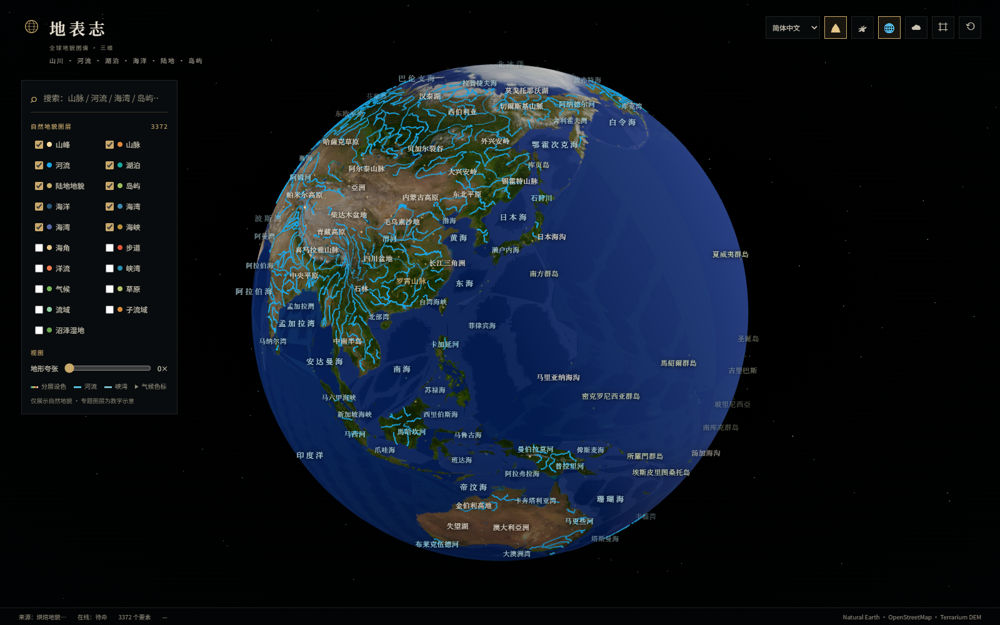
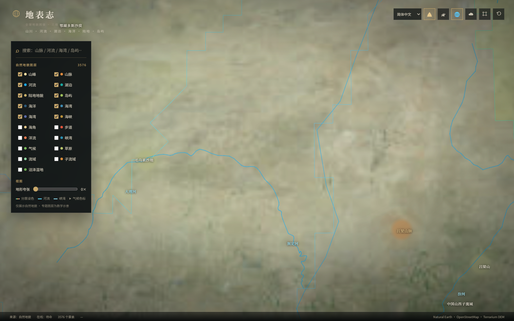
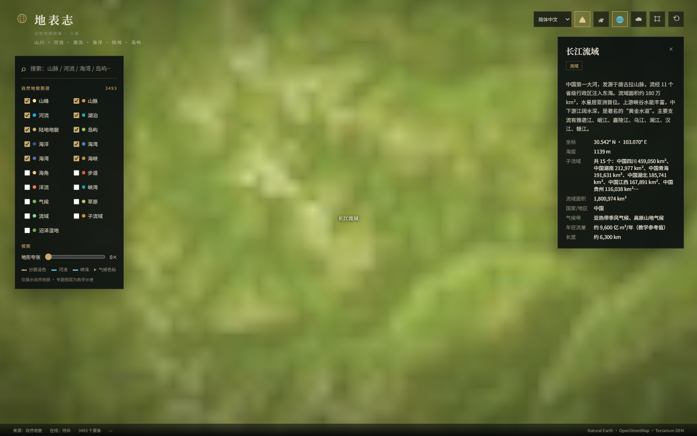

# 地表志 · 全球自然地貌图谱 / Earth Atlas

> 对标谷歌地球的**自然地貌**三维图谱：真实卫星影像 + DEM 地形 + 真实水系 + 流域/气候专题图层，不展示人类建筑。
> A Google-Earth-style 3D atlas of **natural landforms**: real satellite imagery, DEM relief, authentic hydrography, basin and climate overlays — no man-made structures.

[](LICENSE)

---

## 中文介绍

「地表志」是一个面向地理教学与科普的网页版三维地球仪。它只呈现自然地貌——山脉、河流、湖泊、海洋、陆地、岛屿、海湾、海峡、气候带与流域，过滤掉水库、大坝等人工要素。支持 360° 旋转、贴地缩放、13 种界面语言，点击任意要素可查看地貌详情。

近景影像使用 ESRI World Imagery 分级瓦片实时拼贴，远景使用离线 8K 影像；河流采用 Natural Earth 10m 高精度河道（含黄河几字弯、湄公河全河段）；流域与子流域按要素分色，面积来自 Global Water Provinces；气候带来自 Köppen-Geiger 观测分类。

## English introduction

Earth Atlas is a browser-based 3D globe for geography teaching and popular science. It renders **only natural landforms** — mountains, rivers, lakes, oceans, landforms, islands, bays, straits, climate zones and river basins — while filtering out reservoirs, dams and other artificial features. It supports 360° rotation, ground-level zooming, 13 UI languages, and click-to-detail for every feature.

Close-up imagery is assembled in real time from ESRI World Imagery tiles; distant views use an offline 8K texture. Rivers come from Natural Earth 10m hydrography (including the Yellow River's great bend and the full Mekong). Basins and sub-basins are colour-coded per feature with areas from Global Water Provinces; climate zones come from Köppen-Geiger observations.

---

## 截图 / Screenshots

### 全图 / Global view


### 近景 · 流域与河流 / Close-up · basins and rivers


### 点击详情 / Click-to-detail


> 截图由 `node scripts/capture-screenshots.mjs` 生成（需先启动 dev server）。
> Screenshots are generated by `node scripts/capture-screenshots.mjs` with the dev server running.

---

## 功能 / Features

| 中文 | English |
|---|---|
| 真实卫星影像：近景 ESRI 瓦片拼贴（最高 3000+ px 纹理），远景 8K 离线影像，影像/地形浮雕一键切换 | Real satellite imagery: ESRI tiled patches (3000+ px) for close-ups, offline 8K texture for global view; imagery/relief toggle |
| 真实水系：Natural Earth 10m 河道，真实几字弯与出海口；面域水体按类着色 | Authentic hydrography from Natural Earth 10m, real meanders and estuaries; semi-transparent water bodies |
| 19 个自然地貌图层，各自独立勾选、互不干扰；逐类语义化配色 | 19 independent natural-landform layers with distinct semantic colours |
| 流域与子流域分色；点击流域高亮整片并显示面积、占比、排名、精选年径流量与气候带 | Per-feature coloured basins/sub-basins; click highlights the polygon and shows area, share, rank, reference runoff and climate |
| 11 类真实 Köppen 气候分区、4 类植被、13 条洋流、峡湾与沼泽专题 | 11 Köppen climate zones, 4 biome zones, 13 ocean currents, fjords and wetlands |
| 任意要素点击详情：精选数据 + 按类别生成的教学描述、坐标、海拔、气候带、附近地貌 | Click any feature for details: curated facts plus generated teaching text, coordinates, elevation, climate zone and nearby features |
| 地形夸张滑块（0–8×），经纬网，经纬度坐标搜索（`39.9,116.4` / `N39.9 E116.4`） | Terrain exaggeration slider (0–8×), graticule, lat/lon search (`39.9,116.4` / `N39.9 E116.4`) |
| 缩放自适应 LOD：远景降采样、近景保细节，稳态帧时约 2 ms | Distance-based LOD: far-view decimation, full near-view detail, ~2 ms steady-state frame time |
| 13 种界面语言：简中/繁中/英/日/韩/法/俄/德/西/葡/拉丁/阿拉伯/意 | 13 UI languages: Simplified/Traditional Chinese, English, Japanese, Korean, French, Russian, German, Spanish, Portuguese, Latin, Arabic, Italian |

---

## 快速开始 / Quick start

```bash
npm install
npm run dev
# 打开 / open http://127.0.0.1:5173/index2.html
```

构建与测试 / Build and test:

```bash
npm run build     # tsc --noEmit && vite build
npm test          # vitest run
```

数据脚本 / Data scripts:

```bash
npm run data:extract   # 从附件抽取纹理与精选要素 / extract textures & curated features
npm run data:fetch     # 重新拉取 Natural Earth 数据与 DEM / refetch Natural Earth & DEM
npm run data:thematic  # 生成气候/洋流/植被/峡湾/沼泽数据 / regenerate thematic data
npm run screenshots    # 生成 README 截图 / regenerate README screenshots
```

## 技术架构 / Architecture

- 前端：TypeScript + Three.js + Vite + Vitest
- 入口：`index2.html` → `src/v2/main8.ts`（`index.html` 仅重定向）
- 渲染：`features3.ts` 批量渲染 + 顶点分色；`tiles.ts` 瓦片影像层；`globe6.ts` 球体与地形
- 数据：`data4.ts` 静态 GeoJSON 加载；`arcgisData.ts` 在线河流/流域查询；`teaching.ts` 详情生成
- 设计记录：`docs/plans/`

## 数据来源 / Data sources

- 卫星影像：[Esri World Imagery](https://www.arcgis.com/home/item.html?id=10df2279f9684e4a9f6a7f08febac2a9)（通过 ArcGIS REST 瓦片服务访问）
- 矢量底图：[Natural Earth](https://www.naturalearthdata.com/)（公有领域）
- 流域：[Global Water Provinces / HydroSHEDS](https://www.arcgis.com/)（Esri 托管服务）
- 气候：[Köppen-Geiger Climate Classification](https://www.arcgis.com/)
- 高程：[Terrarium tiles](https://registry.opendata.aws/terrain-tiles/)（AWS 开放数据）

> 专题图层为教学示意，流量等数值为公开参考值，不作科研或工程依据。
> Thematic layers are for teaching; discharge figures are public reference values, not for research or engineering use.

## 开源协议 / License

[Apache License 2.0](LICENSE) — 详见 [LICENSE](LICENSE).
